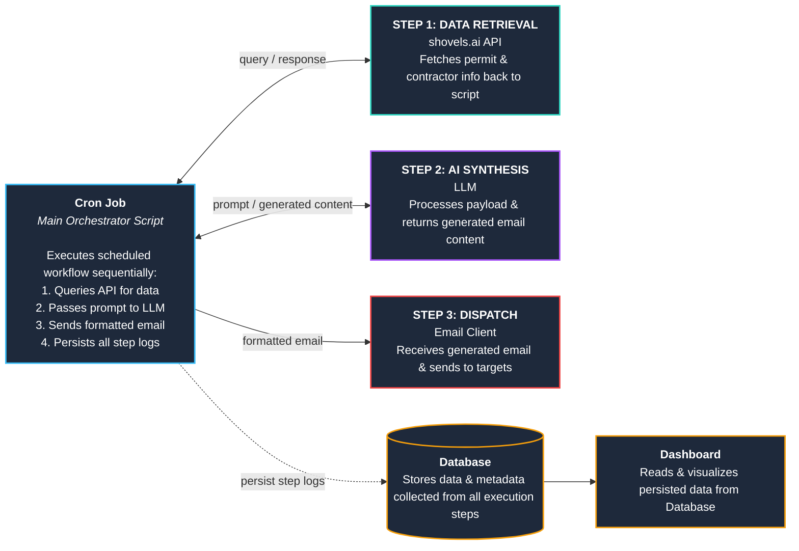

# **CS146S Aut26 Technical Spec**

## **Problem Statement & Target User**

Niche online retailers (e.g., Jojospring) face declining platform search traffic (e.g., Wayfair, Overstock). Direct B2B outreach to high-volume buyers (e.g., contractors) offers a strong growth channel, but small teams lack bandwidth for manual lead research and tailored messaging.

## **System Solution**

An automated pipeline streamlining lead discovery, personalised message synthesis, and email engagement for scalable B2B sales.

## **Success Metrics**

- **Technical:** Delivery success rate, API reliability, workflow uptime.  
- **Business:** Response/conversion rates, new sales revenue.

# **Architecture**

## **Infrastructure & System Workflow**

1. **Ingestion:** Render cron queries [Shovels.ai](http://shovels.ai) API for contractor contacts and permits by location/type.  
2. **Synthesis:** LLM merges contractor context and product catalog to craft tailored pitches.  
3. **Dispatch:** Email service delivers proposals to target contractors.  
4. **Persistence:** Logs delivery, engagement, and statuses in Render PostgreSQL.  
5. **Dashboard:** Web UI displaying campaign performance analytics.

## **Architecture Diagram**

# **API Design**

## **Internal & External Endpoints**

- **Shovels.ai API:** Queries contractor profiles and permit data.  
- **GET /api/dashboard/stats:** Fetches DB metrics (leads, response rates, campaign stats) for frontend.

## **Database Schema Details**

Stores contractor metadata (ID, name, type, email) and outreach logs (sent timestamp, subject, body, status). Stretch: open tracking, thread ID, follow-up body text.

# **Technical Stack**

- **Language:** Python  
- **API Client:** requests library  
- **Data Source:** [Shovels.ai](http://shovels.ai) API  
- **LLM APIs:** Claude 3.5 Sonnet / OpenAI  
- **Hosting/DB:** [Render.com](http://render.com) (PostgreSQL & Cron)  
- **Frontend:** HTML, CSS, Vanilla JS

# **Agent Readiness**

- **Context & Documentation:** Repository includes a repository-level prompt (\`AGENTS.md\`) and file structure maps so AI agents can navigate the codebase autonomously.  
- **Tooling & Scripts:** Standardised CLI routines (\`make test\`, \`make lint\`, \`make dev\`) enable agents to run validations and spin up local environments cleanly.  
- **Modular Architecture:** Clear separation between data ingestion, synthesis, and dispatch components allows targeted agent code edits without unintended side effects.  
- **Integrations access:** [render.com](http://render.com) MCP server and [Shovels | Shovels CLI: Construction Data Straight From Your Terminal](https://www.shovels.ai/features/cli) agent-friendly interface for [shovels.ai](http://shovels.ai) help a coding agent properly understand and build the necessary infrastructure of the system. 